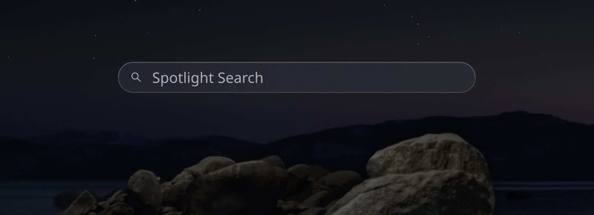
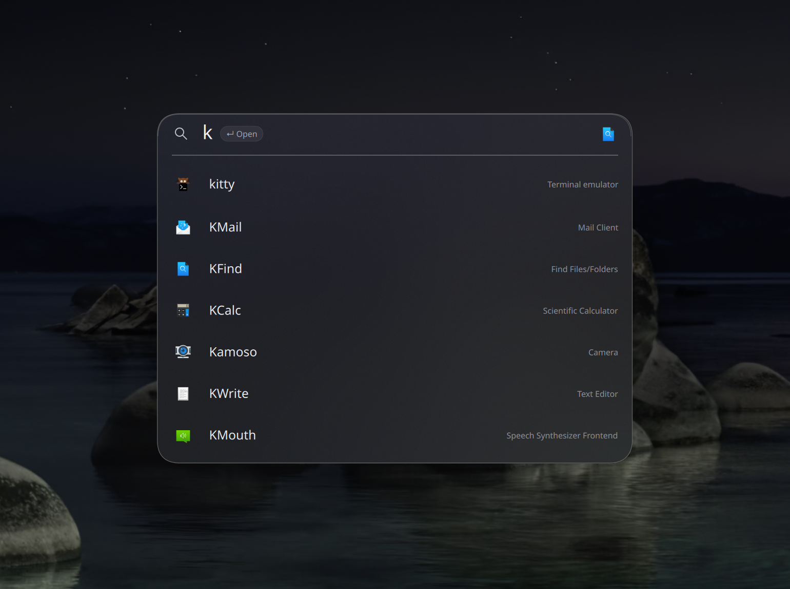
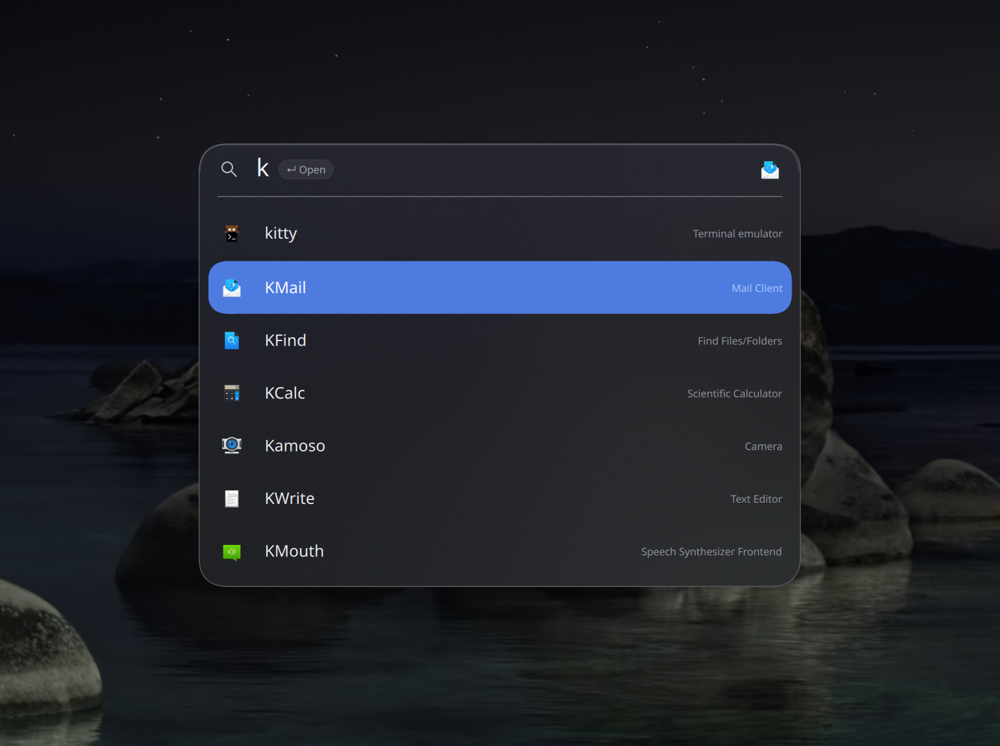

# KRunner macOS Spotlight Theme

**An unofficial Spotlight-inspired native interface for KDE Plasma 6's KRunner.**

> **v0.1.0 — tested source release for Plasma 6.7.5.**
> This is a **custom KRunner executable**, **not** a standard KDE theme, widget,
> plugin, QML-only install, or Apple component. It keeps the underlying KDE
> KRunner providers and D-Bus interface. Do not install a binary from another
> architecture, distro, or Plasma version.

The search window uses a 640-logical-unit continuous-corner glass surface, a
56-unit search header, animated downward result expansion, native KRunner
providers, and macOS-inspired gray hover / blue keyboard focus. Empty search
can reveal a four-action capsule rail. The tinted glass panel deliberately
remains the same color during search and before typing. The optical refinement
variant adds a subtle curved upper rim, a contextual current-app header icon
and a passive `↵ Open` hint for short application queries when space permits. Its tint is a user
preference, not an attempt to copy every pixel of Apple's black panel.

The design is inspired by macOS Spotlight but is independently implemented in
Qt Quick/C++ on Linux. **Not affiliated with or endorsed by Apple or KDE.**

## Current status / accurate compatibility

| Environment | Status |
|---|---|
| Fedora Asahi Remix 44, ARM64, Plasma 6.7.5, Wayland | Native release build, live visual checks, and actual install/update/rollback/uninstall tested |
| Any other distro on Plasma 6.7.5 | Build may work with matching development headers; **not tested** |
| x86_64 Plasma 6.7.5 | Source build possible in principle, **not tested** |
| Plasma earlier or later than 6.7.5 | **Unsupported by this source snapshot**; upstream interfaces can change |
| Plasma 5 | Unsupported |
| X11 | Source has an X11 positioning path; **new release not runtime-tested on X11** |
| macOS / Windows | Unsupported |

The release checks the installed Plasma version (6.7.5), session type
(Wayland/X11), and ELF architecture before installing. A positive preflight
check **does not establish working GUI rendering**. On later Plasma updates,
rebuild from a version-matched upstream snapshot, rather than assuming ABI
compatibility.

## Safe quick start (no one-line remote execution)

Download/review the **source release**, then run these commands in an
ordinary user shell in your KDE desktop session (never `sudo`):

```bash
python3 tools/manage.py check
python3 tools/manage.py build
python3 tools/manage.py install
python3 tools/manage.py status
```

See [Fedora dependency installation](docs/BUILD.md) before building.

Build requires CMake, a C++20 compiler, Qt 6 Quick/Widgets/DBus development
packages, ECM, KDE Frameworks 6 (KIO, I18n, DBusAddons, Crash, Runner,
WindowSystem, Config, Service), Plasma, PlasmaQuick, PlasmaActivities,
LayerShellQt, and the KDE Milou/Kirigami QML modules installed on the target.

The verified host used: Plasma 6.7.5, KF6 6.31, Qt 6.11.2, on aarch64. The
installer **will not** fetch/install missing packages, modify global shortcuts,
change `krunnerrc`, or replace `/usr/bin/krunner`.

`tools/manage.py` replaces the per-user **`plasma-krunner.service` ExecStart**
using only one independently named systemd drop-in:

`~/.config/systemd/user/plasma-krunner.service.d/90-krunner-spotlight.conf`

The built executable is copied to:

`~/.local/share/krunner-spotlight/bin/krunner-spotlight`

The management state and optional rollback binary are in that same data tree.
Pre-existing unit overrides are left untouched. Installation refuses a
*conflicting* ExecStart override until it is reviewed by the user; this includes
the legacy `50-custom-interface.conf` from earlier private prototypes.

For private prototypes using `50-custom-interface.conf`, first restore your
previous launcher with its existing restore script, confirm standard KRunner
starts, and only then use this manager. **Do not delete a conflicting override
blindly:** it could belong to another custom setup.

## Update, rollback, uninstall

From a newly downloaded compatible source tree:

```bash
python3 tools/manage.py check
python3 tools/manage.py build
python3 tools/manage.py update    # only for a managed prior install
python3 tools/manage.py rollback  # restore the immediately preceding managed binary, if any
python3 tools/manage.py uninstall # restore stock KRunner's unit ExecStart
```

Updates back up the prior managed executable, and use atomic replacement.
Restart failures trigger a best-effort rollback of the managed files. `rollback`
is a **one-level binary rollback**, not a substitute for version-matched Plasma
packages. `uninstall` removes only files owned by this manager; it leaves all
other unit drop-ins, provider settings, and shortcuts alone. It refuses to
remove a managed file if it was edited outside the manager.

If systemd cannot be reached, no install is attempted. The manager is
conservative by design and requires a working `systemctl --user` service.
See [recovery details](docs/RECOVERY.md).

## Search, navigation and action behavior

- Start typing to search the user's existing KDE KRunner providers. The results
  panel expands from the same glass surface; no spinner or tint change.
- **Enter:** run/open normal selected result. **Up/Down:** move selection.
- **Tab while results exist:** invoke the first *native KRunner provider action*
  if the selected result supplies one; otherwise no action is performed. Tab
  does **not** change the selected row. Provider-supplied action text appears by
  the right-edge `tab` badge, which is hidden when no action is available.
- **Esc:** close the launcher. **Tab with an empty query:** toggle the accessory
  rail. The rail exposes native applications, files, shell and KDE clipboard
  interfaces; the exact providers available depend on the user's KDE system.
- Apps may show small right-aligned descriptions. Files retain their actual
  subtitle in the row. Internal stale model entries are hidden when their index
  becomes negative, preventing text from old searches overlapping the new ones.

**Native Linux runner actions are not Apple Spotlight's app-scoped search APIs.**
The launcher must never claim those capabilities when no KDE plugin offers them.
Some runner actions execute commands or modify state: inspect the action label
before pressing Tab.

## Keyboard shortcut (optional)

For **Meta/Super+Space** (or Command+Space if a keyboard remapper produces Meta):
open KDE System Settings → Keyboard → Shortcuts, find **KRunner / Run Command**,
then assign Meta+Space if free. Resolve conflicting shortcuts in System Settings.
No global key remapping, Toshy configuration, or shortcut backups are shipped.

## Appearance, accessibility, privacy

The QML sources are in `qml/`; key visual properties are in
`RunCommand.qml`, `SpotlightResult.qml`, and `GlassPanel.qml`. Fonts and
compositor blur vary with display scaling/theme. A compositor without blur
renders tinted translucency but **not** native macOS Liquid Glass; the custom
continuous cubic is an approximation of the screenshots, not Apple's material.
The UI has accessible row descriptions and keyboard navigation; screen reader,
reduced-motion, high-contrast, multiple-display and fractional-scaling behavior
still requires community validation. Custom animations do not presently honor
all desktop accessibility animation preferences.

KRunner uses existing installed providers and their normal data sources,
possibly including local files and KRunner history. This fork adds **no
telemetry, remote services, account credentials or search upload endpoint**.
Provider-specific privacy behavior is inherited from KDE plugins; check their
settings. Diagnostic screenshot captures only run if explicitly opted in via
`KRUNNER_SPOTLIGHT_PREVIEW` and should not be posted before reviewing filenames,
queries, app names, and window content.

## Screenshots on Tahoe Night

Actual KDE Wayland captures of the running interface, with the Tahoe Night
wallpaper behind it. Only framing was cropped; the interface and compositor blur
were not composited onto the wallpaper afterward.

**Search bar**



**Expanded results**



**Keyboard selection**



Wallpaper: Apple's Tahoe Night, obtained from [Low End Mac's Tahoe wallpaper collection](https://lowendmac.com/2025/the-new-macos-tahoe-evening-morning-and-night-wallpapers/).
The wallpaper is shown as desktop context in these demonstration screenshots;
it is not installed by this project or included as a standalone wallpaper asset.
Third-party wallpaper and application icon rights remain with their owners.
Private Mac reference screenshots and personal desktop/configuration backups are excluded.

## Validation for v0.1.0

- Native release build: Fedora Asahi Remix 44, ARM64, Plasma 6.7.5, Qt 6.11.2,
  KF6 6.31, Wayland.
- 16 automated tests pass: 13 isolated installer tests and 3 static visual contracts.
- Live native-app selection, contextual icon/Open hint, file subtitles, long queries,
  calculator, repeated `import` → `s`, and bottom selected-row clearance checked.
- Actual user-service install, update, one-level rollback and uninstall exercised;
  the owner's previous override was temporarily set aside and restored afterward.
- Tab badge measured at 10 logical points from the row right edge; selected bottom
  clearance matched the sides within one screenshot pixel at the host's scaling.

Other platforms, perceptual animation quality, IME and assistive technology still
need community testing. This release does not claim universal Linux compatibility.
See [validation details](docs/VALIDATION.md).

## More documentation

[Visual QA and measurements](docs/VISUAL-QA.md) ·
[Optical refinement / screenshot checklist](docs/VISUAL-REFINEMENT.md) ·
[Build & support](docs/BUILD.md) ·
[Troubleshooting & recovery](docs/RECOVERY.md) ·
[Change log](CHANGELOG.md) ·
[Contributing](CONTRIBUTING.md) ·
[Security](SECURITY.md) ·
[Licenses & attribution](LICENSES/README.md) ·
[Release gate](docs/RELEASE-CHECKLIST.md)

Upstream KRunner source: [KDE plasma-workspace 6.7.5](https://github.com/KDE/plasma-workspace/tree/v6.7.5/krunner).
Reference inspiration: [Spotlight Liquid Glass OS 26 Clone](https://github.com/NESDUB/Spotlight-Liquid-Glass-OS26-Clone)
(read-only reference, not bundled with this Linux runtime).
